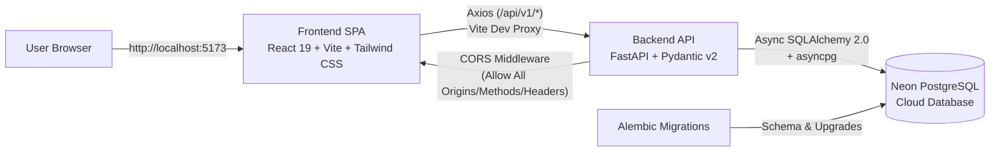
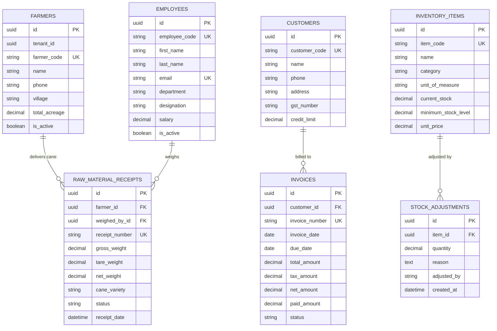

# Sugar Mill ERP

A full-stack **Enterprise Resource Planning (ERP)** web application designed for sugar mill operations—covering raw material cane procurement, farmer ledgers, inventory & stock adjustments, wholesale sales & invoicing with partial payment tracking, workforce management, and live operational dashboards.

---

## System Architecture



### Request Lifecycle
1. **Client UI (`frontend/`)**: React 19 SPA with React Router, React Hook Form, and Zod client-side validation.
2. **API Transport**: Axios (`src/services/api.js`) sends requests to `/api/v1/...`, proxied by Vite (`vite.config.js`) to the FastAPI backend (`http://127.0.0.1:8000`).
3. **API & Validation (`BACKEND/`)**: FastAPI routes validate payloads via Pydantic v2 schemas, enforce uniqueness and foreign-key checks, and execute async database operations.
4. **Persistence**: SQLAlchemy 2.0 (`asyncpg`) persists multi-tenant (`tenant_id`), UUID-keyed, timestamped records in Neon PostgreSQL.

---

## Database Schema (ERD)



---

## Tech Stack

### Frontend
* **Framework:** React 19 + Vite 8
* **Styling:** Tailwind CSS v4 + Lucide React Icons
* **Routing:** React Router v7 (`ProtectedRoute` + nested module routes)
* **Forms & Validation:** React Hook Form + Zod (`@hookform/resolvers`)
* **HTTP Client:** Axios

### Backend
* **Framework:** FastAPI + Uvicorn (ASGI)
* **ORM & Driver:** SQLAlchemy 2.0 (Async) + `asyncpg`
* **Migrations:** Alembic
* **Validation & Config:** Pydantic v2 + `pydantic-settings`
* **Database:** PostgreSQL (Neon DB with automatic URL & SSL normalization)
* **Package Manager:** `uv` (Python >= 3.14)

---

## Features & Use Cases

### 1. Dashboard (`/dashboard`)
* **KPI Cards:** Live aggregation of Today's Sales, Month Sales, Outstanding Receivables, and Active Employees.
* **Alerts:** Real-time **Low Stock Alerts** (`current_stock <= minimum_stock_level`) and **Overdue Invoices**.
* **Quick Actions & Activity Feed:** One-click shortcuts to create sales, log farmer receipts, or record attendance.

### 2. Inventory Management (`/inventory`)
* **Item Master (`/inventory/items`):** Full CRUD for chemicals (Sulfur Powder, Lime Stone, Phosphoric Acid), spare parts, finished goods (Raw Sugar M-30, Molasses), and consumables with automatic **In Stock / Low Stock / Out of Stock** status chips.
* **Stock Adjustments (`/inventory/adjustments`):** Record positive (`+`) restocks or negative (`-`) deductions with mandatory reasons. Atomically updates `current_stock` in PostgreSQL, prevents negative stock, and logs an immutable audit trail in `stock_adjustments`.

### 3. Farmers & Procurement (`/farmers`)
* **Farmer Directory (`/farmers/directory`):** Register and manage sugarcane growers, villages, contact numbers, and acreage.
* **Raw Material Receipts (`/farmers/receipts`):** Weighbridge slip entry calculating **Gross Value** (`net_weight × rate`) and **Net Payable** (`gross - moisture/trash deductions`), persisted to `raw_material_receipts`.

### 4. Sales & Billing (`/sales`)
* **Customers (`/sales/customers`):** Manage wholesale buyers, traders, and distributors with credit limits and city/address details.
* **Invoices (`/sales/invoices`):** View all sales invoices with **Total Amount**, **Remaining Amount** (`net_amount - paid_amount`), and status chips (`Paid`, `Partial`, `Overdue`, `Draft`). Includes a **Record Payment** modal supporting partial and full settlements across Cash, NEFT, UPI, and Cheque.
* **Create Invoice (`/sales/invoices/new`):** Multi-line invoice builder with live subtotal, tax %, and grand total calculation.

### 5. Labour & Workforce (`/labour`)
* **Employees (`/labour/employees`):** Full CRUD for mill operators, technicians, shift supervisors, accountants, and weighbridge officers across departments.
* **Attendance (`/labour/attendance`):** Daily shift roll-call with bulk actions (*Mark All Present / Absent / Overtime*).

### 6. Settings & Access Control (`/settings`)
* **General Settings (`/settings/general`):** Configure mill/tenant name, currency (`INR` / `USD`), timezone, and financial year start.
* **User Roles (`/settings/roles`):** Interactive RBAC permission matrix for **Admin**, **Manager**, **Accountant**, and **Operator**.

---

## Project Structure

```text
Sugar-Mill/
├── BACKEND/
│   ├── alembic/
│   │   ├── env.py
│   │   └── versions/               # Alembic database migrations
│   ├── src/sugarmill_erp/
│   │   ├── api/v1/                 # FastAPI routers (farmers, customers, inventory, employees, invoices, receipts)
│   │   ├── core/                   # config.py (URL normalizer), database.py, exceptions.py
│   │   ├── crud/                   # Async CRUD repositories
│   │   ├── models/                 # SQLAlchemy ORM models
│   │   ├── schemas/                # Pydantic v2 request/response schemas
│   │   ├── main.py                 # FastAPI app, CORS, lifespan & health endpoints
│   │   └── seed.py                 # Initial database seeder
│   ├── .env                        # Backend database environment variables
│   ├── alembic.ini
│   └── pyproject.toml
│
└── frontend/
    ├── src/
    │   ├── components/             # Sidebar, Topbar, DataTable, Modal, ConfirmModal, Button, Input, Select, StatusChip
    │   ├── context/                # AuthContext, TenantContext
    │   ├── hooks/                  # useAuth, useFetch, useDebounce
    │   ├── layouts/                # DashboardLayout
    │   ├── pages/                  # Auth, Dashboard, Inventory, Farmers, Sales, Labour, Settings
    │   ├── services/               # api.js (Axios instance + interceptors)
    │   ├── utils/                  # formatters.js, mockData.js
    │   └── App.jsx                 # Router & ProtectedRoute
    ├── .env                        # Frontend VITE_API_BASE_URL=/api/v1
    ├── vite.config.js              # Vite + Tailwind + API proxy config
    └── package.json
```

---

## API Reference

| Module | Endpoints | Description |
| :--- | :--- | :--- |
| **Health** | `GET /`, `GET /health` | API info & live PostgreSQL connectivity check |
| **Farmers** | `GET/POST /api/v1/farmers/`, `GET/PUT/DELETE /api/v1/farmers/{id}` | Farmer directory CRUD |
| **Raw Material Receipts** | `GET/POST /api/v1/raw-material-receipts/`, `GET/PUT/DELETE /{id}` | Cane weighment slips |
| **Inventory** | `GET/POST /api/v1/inventory/`, `GET/PUT/DELETE /api/v1/inventory/{id}` | Item master CRUD |
| **Stock Adjustments** | `GET/POST /api/v1/inventory/adjustments` | Atomic stock adjustments & audit history |
| **Customers** | `GET/POST /api/v1/customers/`, `GET/PUT/DELETE /api/v1/customers/{id}` | Buyer directory CRUD |
| **Invoices** | `GET/POST /api/v1/invoices/`, `GET/PUT/DELETE /api/v1/invoices/{id}` | Sales invoices & `paid_amount` updates |
| **Employees** | `GET/POST /api/v1/employees/`, `GET/PUT/DELETE /api/v1/employees/{id}` | Workforce directory CRUD |

Interactive Swagger documentation is available at **`http://localhost:8000/docs`**.

---

## Getting Started

### 1. Backend Setup

Configure `BACKEND/.env`:
```env
DATABASE_URL=postgresql+asyncpg://<user>:<password>@<host>/<db>?ssl=require
```
*(Note: Standard `postgresql://...?sslmode=require&channel_binding=require` URLs are automatically normalized for `asyncpg` by `core/config.py`.)*

Install dependencies, run migrations, and seed initial data:
```powershell
cd BACKEND
uv sync
uv run alembic upgrade head
uv run python -m sugarmill_erp.seed
```

Start the Backend Server:
```powershell
uv run uvicorn sugarmill_erp.main:app --host 0.0.0.0 --port 8000 --reload
```
* **Backend API:** `http://localhost:8000`
* **Swagger Docs:** `http://localhost:8000/docs`

### 2. Frontend Setup

Configure `frontend/.env`:
```env
VITE_API_BASE_URL=/api/v1
```

Install dependencies and start the Vite dev server:
```powershell
cd frontend
npm install
npm run dev
```
* **Frontend App:** `http://localhost:5173`

### Demo Login Credentials
* **Email:** `admin@sugarmill.com`
* **Password:** `password`

